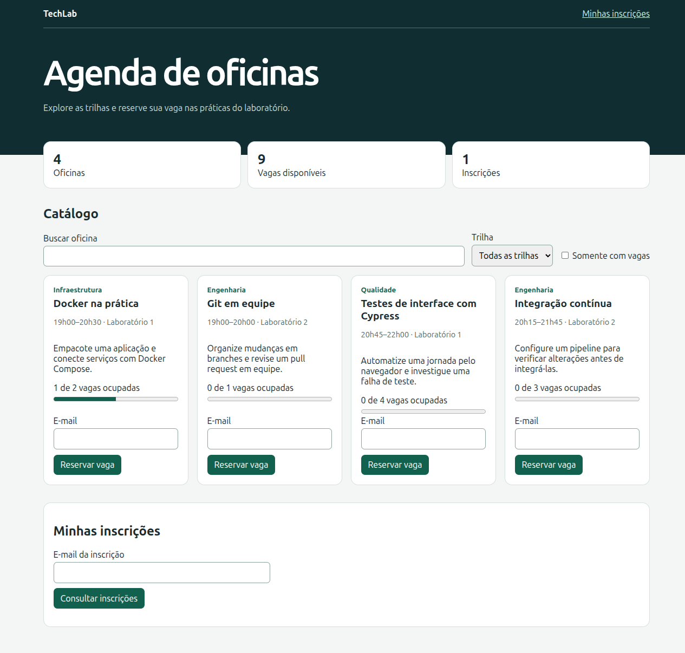
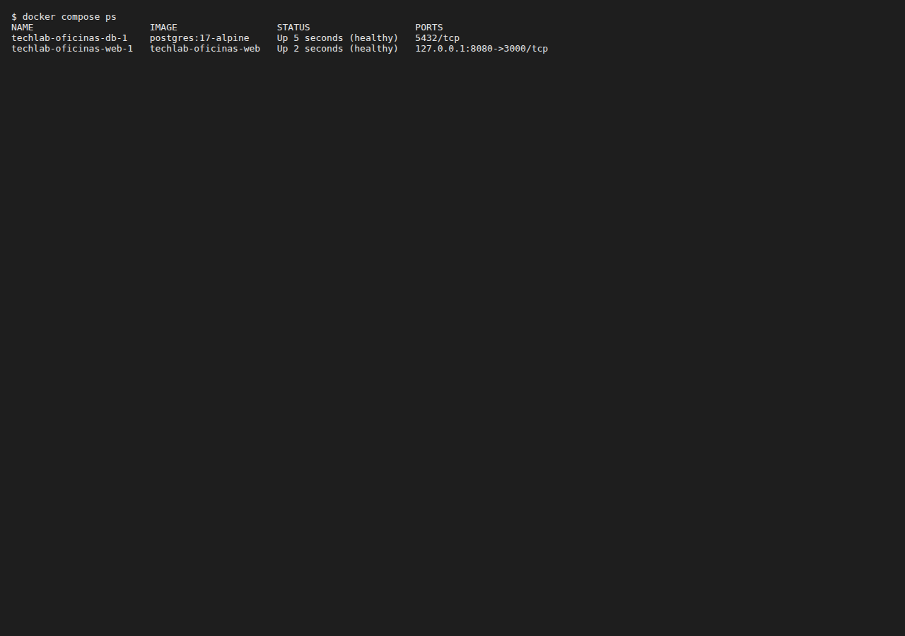
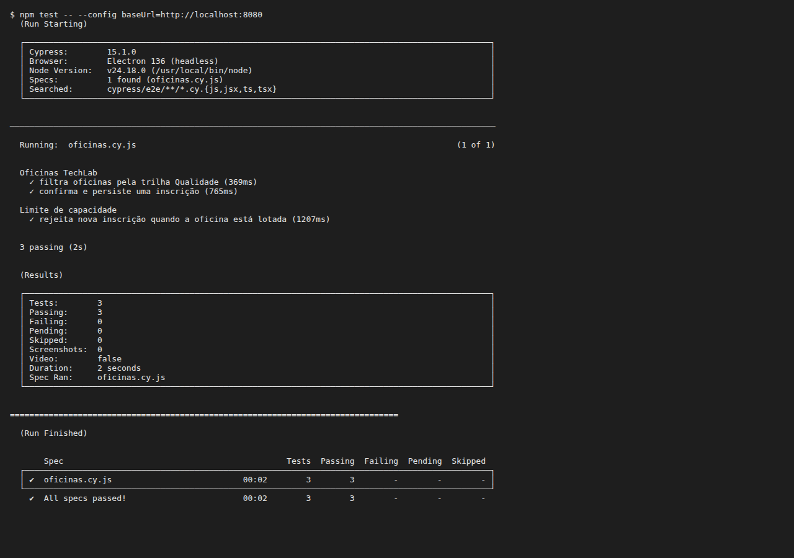
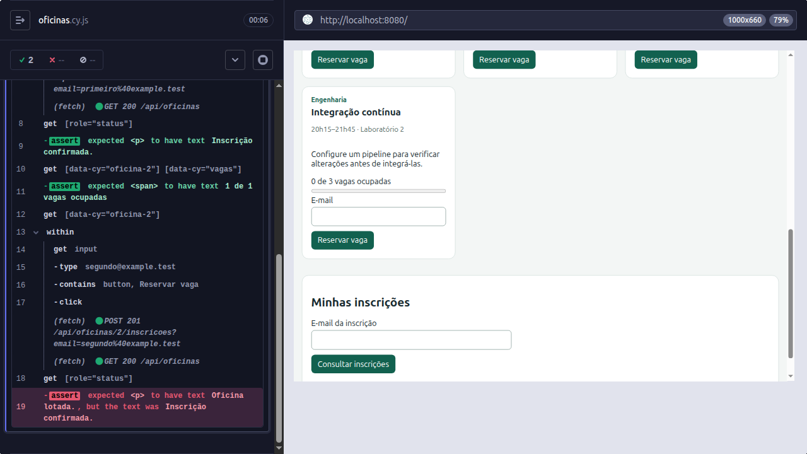

# Relatório — Prática guiada QA e DevOps com TechLab

Repositório: https://github.com/RichardPedroso/Techlab

## 1. Aplicação em funcionamento e `docker compose ps`

Aplicação acessada em `http://localhost:8080`, com as quatro oficinas do catálogo. A captura foi feita após reservar uma vaga em "Docker na prática" com um e-mail fictício e recarregar a página (a inscrição continuou registrada). Em seguida, a inscrição foi consultada em "Minhas inscrições" e cancelada; a busca e o filtro de trilha também foram testados.



Os dois serviços ficaram saudáveis, inclusive depois de `docker compose down` e `docker compose up -d --wait web`:



## 2. Resultado dos testes Cypress

Execução no terminal (`npm test -- --config baseUrl=http://localhost:8080`) após a correção, com os três testes aprovados. A suíte também passou dentro do contêiner, com `docker compose -p techlab-testes run --rm e2e`.



Captura gerada pelo Cypress quando o teste de lotação falhou, antes da correção:



## 3. Execuções no GitHub Actions

| Execução | Commit | Resultado | Link |
|---|---|---|---|
| Verde inicial | `29fdf90` Configura pipeline de integração contínua | 2 testes aprovados | https://github.com/RichardPedroso/Techlab/actions/runs/45505683885 |
| Vermelha (teste de lotação) | `c494a0a` Testa limite de vagas de uma oficina | 1 teste falhou | https://github.com/RichardPedroso/Techlab/actions/runs/45506069255 |
| Verde após a correção | `c4bf6bd` Corrige regra de limite de vagas | 3 testes aprovados | https://github.com/RichardPedroso/Techlab/actions/runs/45506474685 |

## 4. Defeito encontrado

A oficina "Git em equipe" tem uma única vaga. Na função `inscrever` de `web/server.js`, a verificação de lotação era:

```js
if (inscritos.rowCount > oficina.rows[0].vagas) {
```

Com um inscrito e uma vaga, a expressão fica `1 > 1`, que é falsa. Por isso o segundo pedido era aceito e a oficina passava a ter mais inscritos do que vagas.

- **Esperado:** a segunda inscrição é recusada com a mensagem `Oficina lotada.` e a contagem continua em `1 de 1 vagas ocupadas`.
- **Observado:** a segunda inscrição foi aceita com a mensagem `Inscrição confirmada.`. Saída do Cypress: `expected 'Inscrição confirmada.' to have text 'Oficina lotada.'`.

**Correção:** a inscrição passou a ser recusada quando o número de inscritos já é igual ou maior que a capacidade:

```js
if (inscritos.rowCount >= oficina.rows[0].vagas) {
```

## 5. Respostas

**Por que usar um volume para o PostgreSQL?**
O sistema de arquivos de um contêiner é descartado junto com ele. O volume `dados`, montado em `/var/lib/postgresql/data`, guarda as tabelas e as inscrições fora do contêiner, então os dados continuam lá depois de `docker compose down` e `up` ou de uma atualização da imagem. O script `init.sql` também só roda quando o volume está vazio, o que impede que o banco seja recriado a cada subida.

**Por que o navegador do host usa `localhost:8080` e o Cypress em Docker usa `web:3000`?**
O navegador roda na máquina hospedeira, que só alcança a aplicação pela porta publicada no Compose (`127.0.0.1:8080:3000`, ou seja, a porta 8080 do host aponta para a 3000 do contêiner). O Cypress em Docker roda na mesma rede interna do Compose. Nessa rede, cada serviço é encontrado pelo nome (`web`) e acessado diretamente na porta interna (3000). Dentro do contêiner do Cypress, `localhost` seria o próprio contêiner, e não a aplicação.

**Por que a primeira suíte verde não garantiu que todas as regras estavam corretas?**
Os testes só verificam os cenários que foram escritos. A primeira suíte cobria o filtro por trilha e uma inscrição válida, mas nenhum teste tentava inscrever alguém em uma oficina já lotada, então o defeito no limite de vagas passou sem ser notado. Uma execução verde mostra que nenhum dos cenários cobertos falhou; ela não prova que o sistema não tem defeitos.

**Qual a diferença entre confirmação e regressão na última execução?**
O teste de confirmação é o novo caso "rejeita nova inscrição quando a oficina está lotada": ele falhou antes da correção e passou depois, o que confirma que o defeito foi resolvido. O teste de regressão é a nova execução dos dois testes que já existiam (filtro e inscrição com persistência), que garante que a alteração em `server.js` não quebrou o que já funcionava. Na última execução os três passaram.
